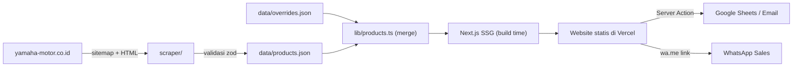

# Arsitektur

## Stack

| Lapisan | Teknologi |
|---|---|
| Framework | Next.js 15 (App Router), TypeScript, React Server Components |
| UI | Tailwind CSS, shadcn/ui, lucide-react, Swiper/embla (galeri) |
| Scraper | Node.js 20+, `fetch`, `cheerio`, `zod`, `p-limit` |
| Data | File JSON di `data/` (di-commit ke Git) |
| Lead | Server Action → Google Sheets API / Resend (email) |
| Otomasi | GitHub Actions (cron mingguan) |
| Hosting | Vercel |

## Alur Data



1. **Scrape** (mingguan / manual) → `data/products.json`.
2. **Merge** dengan `data/overrides.json` (harga daerah, promo, produk disembunyikan, gambar lokal).
3. **Build** statis: setiap produk → halaman `/motor/[slug]`.
4. Commit data baru memicu **redeploy otomatis** di Vercel.

## Struktur Folder

```
persadamotor/
├─ app/
│  ├─ page.tsx                 # Beranda
│  ├─ motor/page.tsx           # Katalog + filter
│  ├─ motor/[slug]/page.tsx    # Detail produk
│  ├─ bandingkan/page.tsx
│  ├─ simulasi-kredit/page.tsx
│  ├─ test-ride/page.tsx       # Form lead (Server Action)
│  ├─ kontak/page.tsx
│  └─ sitemap.ts, robots.ts
├─ components/
│  ├─ product-card.tsx
│  ├─ variant-color-picker.tsx
│  ├─ spec-table.tsx
│  ├─ credit-calculator.tsx
│  └─ whatsapp-button.tsx
├─ lib/
│  ├─ products.ts              # load + merge + query
│  ├─ schema.ts                # zod schema (dipakai scraper & app)
│  ├─ format.ts                # formatRupiah, slugify
│  └─ config.ts                # data dealer dari env
├─ scraper/
│  ├─ index.ts                 # entry: npm run scrape
│  ├─ fetch.ts                 # rate limit, retry, cache, UA
│  ├─ sitemap.ts               # ambil daftar URL produk
│  ├─ selectors.ts             # semua selector CSS di satu tempat
│  ├─ parse-product.ts         # HTML → Product
│  └─ __fixtures__/            # HTML contoh untuk test
├─ data/
│  ├─ products.json            # hasil scrape (JANGAN edit manual)
│  ├─ overrides.json           # edit manual oleh admin/sales
│  └─ scrape-report.json
├─ public/images/products/     # aset resmi dari dealer (opsional)
├─ .cache/html/                # HTML mentah (gitignored)
├─ .github/workflows/scrape.yml
└─ docs/
```

## Prinsip Desain

- **Scraping terpisah dari runtime** — website tidak pernah memanggil situs Yamaha saat diakses pengunjung.
- **Satu skema** (`lib/schema.ts`) untuk scraper dan aplikasi → tipe selalu sinkron.
- **Selector terpusat** (`scraper/selectors.ts`) → perubahan situs sumber cukup diperbaiki di satu file.
- **Mobile-first** — mayoritas calon pembeli datang dari WhatsApp/Instagram di HP.
- **Gagal aman** — scrape gagal tidak merusak data/website yang sudah live.

