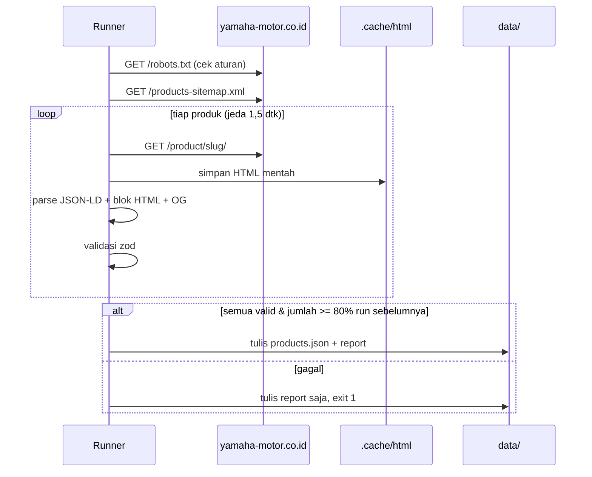

# Scraper Produk Yamaha

## Ringkasan

| Item | Nilai |
|---|---|
| Sumber | https://www.yamaha-motor.co.id/ |
| Daftar produk | `/products-sitemap.xml` (±28 produk) |
| Teknik | HTTP fetch + `cheerio` (situs server-rendered, tanpa headless browser) |
| Output | `data/products.json`, `data/scrape-report.json` |
| Jadwal | Mingguan (Senin 02:00 WIB) via GitHub Actions + manual |

Detail selector CSS/JSON-LD: [.agents/skills/yamaha-sales-website/references/scraping-selectors.md](../.agents/skills/yamaha-sales-website/references/scraping-selectors.md)

## Alur



## Data yang Diambil

| Data | Sumber di halaman |
|---|---|
| Nama, deskripsi | JSON-LD `ProductGroup` |
| Kategori | JSON-LD `BreadcrumbList` (item ke-3) |
| Varian + harga OTR | Blok `.sec2-color-tag3` |
| Warna (nama, hex, gambar) | `.sec2-color-div` (`data-src`, `style`), `.sec2-swiper-img` |
| Fitur unggulan | `.sec3-swiper-div` |
| Spesifikasi (Mesin, Rangka, Dimensi, Kelistrikan) | `.sec4-title-txt` + `.sec4-table` |
| Aksesoris terkait | `.sec7-col` |
| FAQ | JSON-LD `FAQPage` |
| Gambar utama | `og:image` |

## Perintah

```bash
npm run scrape                              # semua produk
npm run scrape -- --only=grand-filano       # satu produk
npm run scrape -- --verbose                 # log detail per field
npm run scrape -- --offline                 # parse ulang dari .cache tanpa request
npm run scrape -- --dry-run                 # tidak menulis ke data/
```

## Etika & Kepatuhan

- **robots.txt**: hanya mengakses path yang diizinkan. `/uploads/` (gambar) **Disallow** → scraper hanya menyimpan URL gambar, tidak mengunduh.
- **Rate limit**: 1 request bersamaan, jeda ≥ 1,5 detik, retry maks 3× (backoff eksponensial) untuk 429/5xx.
- **User-Agent**: `PersadaMotorBot/1.0 (+mailto:kontak@domain-dealer)`.
- **Frekuensi**: mingguan sudah cukup; harga Yamaha jarang berubah harian.
- **Gambar**: keputusan proyek = **hotlink**. Website menampilkan URL asli `https://www.yamaha-motor.co.id/uploads/...` dengan `` biasa (dimuat browser pengunjung). Tidak memakai `next/image` untuk gambar ini agar server kita tidak mengunduhnya. Jika kelak tersedia aset resmi, taruh di `public/images/products/<slug>/` dan daftarkan di `overrides.json`.

## Penanganan Error

| Kondisi | Perilaku |
|---|---|
| HTTP 429 / 5xx | Retry dengan backoff; tetap gagal → produk dilewati + warning |
| Field wajib kosong (nama, kategori, varian/harga) | Validasi gagal → produk ditandai error |
| Produk valid < 80% dari run sebelumnya | **Tidak menulis** `products.json`, exit 1 → workflow merah + notifikasi |
| Produk baru muncul | Ditambahkan otomatis |
| Produk hilang dari sitemap | Dihapus dari JSON (atau tetap jika di-`pin` di overrides) |

## Troubleshooting

1. **Field kosong untuk semua produk** → struktur situs berubah. Buka `.cache/html/<slug>.html`, cari teks yang diketahui (nama warna, "Tipe Mesin", "Rp "), perbarui `scraper/selectors.ts` + dokumen selector, refresh fixture, `npm test`.
2. **Harga beda dengan situs** → cek apakah harga diambil dari FAQ JSON-LD (fallback) bukan blok `sec2`; FAQ bisa usang.
3. **403/blokir** → turunkan frekuensi, pastikan UA & jeda benar. Jangan memakai proxy/rotasi IP untuk menghindari blokir — hubungi pihak Yamaha/dealer untuk akses resmi.
4. **Slug huruf besar** (mis. `all-new-R15-connected`) → fetch pakai slug asli, route website pakai `id` lowercase.

## Testing

- Fixture HTML di `scraper/__fixtures__/` (min. matic, sport, off-road).
- `npm test` memastikan parser menghasilkan objek valid & nilai kunci (mis. harga Grand Filano Hybrid Lux = 29145000 pada fixture).
- Perbarui fixture setiap kali selector diubah.

